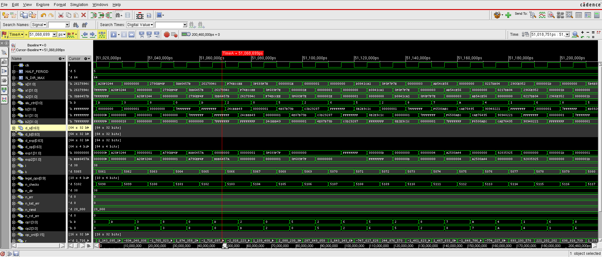
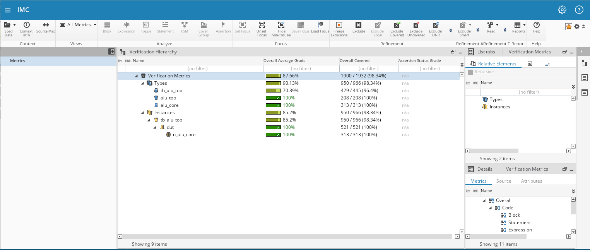
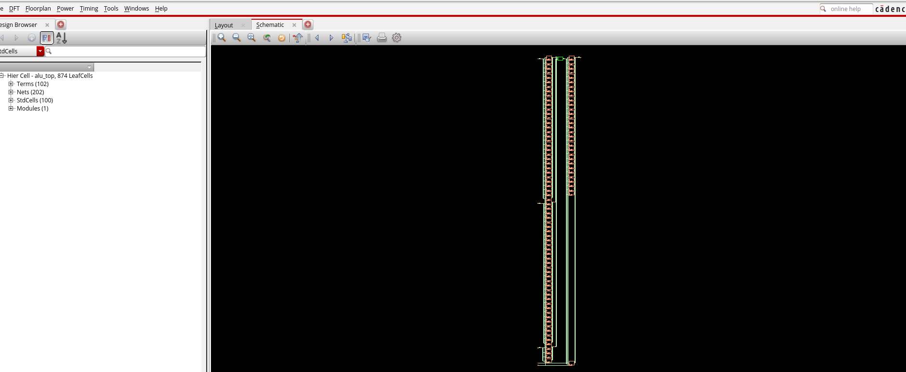
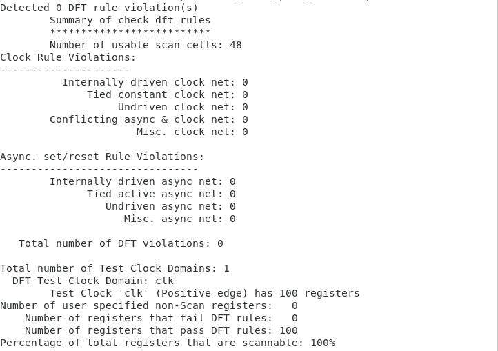
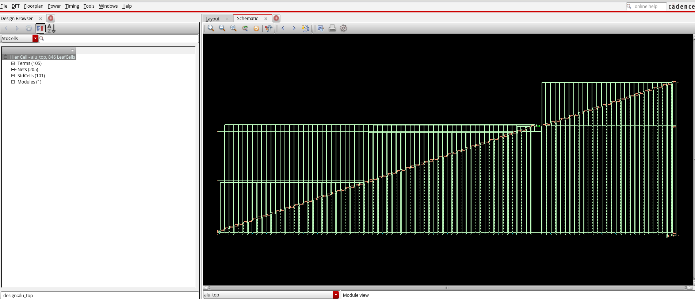
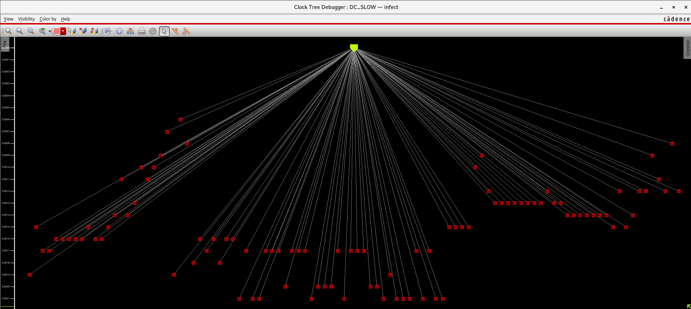
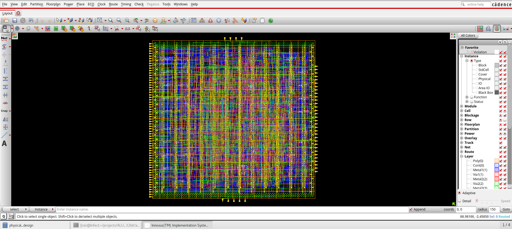
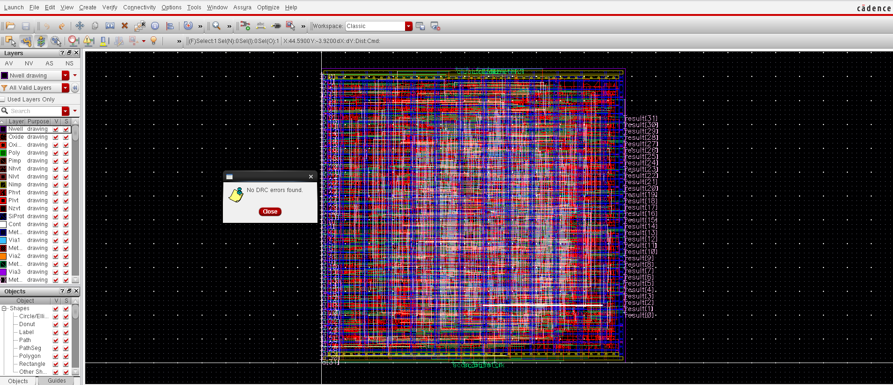
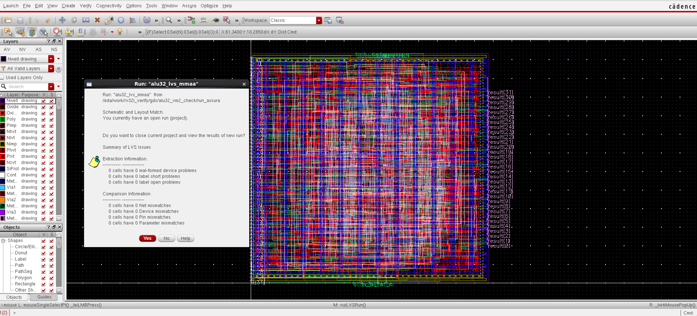

# 32-bit RISC-V (RV32I) ALU — RTL-to-GDSII in 45 nm

[](https://github.com/Zhungg/ALU_32bit/actions/workflows/ci.yml)
[](https://riscv.org/)
[](https://www.cadence.com/)
[](NOTICE.md)
[](#physical-design-and-signoff)
[](LICENSE)

A 32-bit integer ALU implementing the ten computational operations of the
**RISC-V RV32I** base ISA, taken through a complete **Cadence RTL-to-GDSII flow**
(simulation → synthesis → DFT scan insertion → place & route → DRC/LVS) on the
**gpdk045 / gsclib045 45 nm** standard-cell library.

This repository holds everything needed to follow or reproduce the flow: RTL,
self-checking testbench, SDC constraints, Genus / Innovus / Modus / Conformal
scripts, and the generated netlists and signoff evidence.

> **Scope note.** The Cadence tools and the GPDK045 PDK are licensed products and are
> **not** distributed here. See [NOTICE.md](NOTICE.md).

## Contents

- [Results at a glance](#results-at-a-glance)
- [Design](#design)
- [Flow walkthrough](#flow-walkthrough)
- [Repository layout](#repository-layout)
- [Getting started](#getting-started)
- [Contributing](#contributing) · [License](#license)

---

## Results at a glance

| Item | Result |
| :--- | :--- |
| Target clock | 100 MHz (10 ns), functional mode · 20 MHz (50 ns), scan-shift mode |
| Functional verification | 20 040 self-checks (known-answer, directed, 20 000 random, async reset), 0 errors, **TEST PASSED** |
| Code coverage (DUT: `alu_top`, `alu_core`) | **100 %** (521 / 521 covered items, Xcelium `-coverage all`) |
| Synthesis (Genus, slow corner 0.9 V / 125 °C) | 846 cells, 2302 µm² total cell area (scan-inserted netlist) |
| DFT | 100 scan flops, **1 chain**, **0 DFT rule violations** |
| ATPG (Modus, stuck-at) | **99.96 %** test coverage (**100 %** adjusted), 8134 faults, 109 test sequences |
| Post-route setup (reg2reg WNS, func + scan views, slow 0.9 V / 125 °C) | **+1.537 ns**, 0 violating paths |
| Post-route hold (reg2reg WNS, func + scan views, fast 1.1 V / 0 °C) | **+0.029 ns**, 0 violating paths |
| DRC (Innovus `verify_drc`, Virtuoso/Assura) | **0 violations** |
| LVS (Assura) | **Match** — 0 net / device / pin / parameter mismatches |
| Power (post-route, `FUNC_SETUP_VIEW`, 0.2 toggle activity, 10 ns clock) | ≈ 0.076 mW @ 0.9 V |

The numbers above are quoted from the reports produced by the flow, kept in the repo:

| Stage | Evidence |
| :--- | :--- |
| Simulation | [`simulation/xrun_rtl.log`](simulation/xrun_rtl.log) |
| Synthesis / DFT | [`synthesis/reports/`](synthesis/reports/), [`synthesis/dft_run/reports/`](synthesis/dft_run/reports/) |
| ATPG | [`synthesis/atpg/`](synthesis/atpg/) |
| Equivalence check | [`equivalence_checking/reports/`](equivalence_checking/reports/) |
| Place & route signoff | [`physical_design/signoff/`](physical_design/signoff/) |
| Screenshots | [`img/`](img/) |

The bulky raw Innovus/Voltus reports, databases and GDS are git-ignored; regenerate them with the scripts below.

---

## Design

`alu_top` wraps the purely combinational `alu_core` between an input register
stage and an output register stage, mimicking the EX stage of a pipelined RISC-V
core. This turns the ALU's critical path into a real register-to-register path
that STA, CTS and hold fixing can work on.

```
            +--------+      +-----------+      +--------+
   a    -->| a_q    |----->|           |      |        |
   b    -->| b_q    |----->| alu_core  |----->| result |--> result[31:0]
   ctrl -->| ctrl_q |----->| (comb.)   |      |  reg   |
            +--------+      +-----------+      +--------+
             68 FF                              32 FF
   clk, rst_n (async, active low)           = 100 flip-flops

   Added by Genus at scan insertion (not in RTL):  SE, scan_in -> 1 chain -> scan_out
```

- **Latency:** 2 clock cycles; **throughput:** 1 operation per cycle.
- **Reset:** asynchronous, active-low (`rst_n`), clears all 100 flops.
- **Resource sharing:** `ADD`, `SUB`, `SLT`, `SLTU` share a single 33-bit adder
  (`a + ~b + 1` for subtraction/compare).
- **No flags:** RISC-V has no condition codes; the ALU outputs only `result[31:0]`.
- **Illegal `alu_ctrl`:** returns `32'h0` (no latch inferred).

### Ports of `alu_top`

| Port | Dir | Width | Description |
| :--- | :---: | :---: | :--- |
| `clk` | in | 1 | System clock |
| `rst_n` | in | 1 | Asynchronous reset, active low |
| `a` | in | 32 | Operand A (`rs1`) |
| `b` | in | 32 | Operand B (`rs2` / immediate); `b[4:0]` is the shift amount |
| `alu_ctrl` | in | 4 | Operation select `{funct7[5], funct3}` |
| `result` | out | 32 | Registered result, valid 2 cycles after the operands |

### Operations (`alu_ctrl = {funct7[5], funct3}`)

| `alu_ctrl` | Op | Instruction(s) | Result |
| :---: | :---: | :--- | :--- |
| `4'b0000` | ADD  | `add`, `addi`   | `a + b` |
| `4'b1000` | SUB  | `sub`           | `a - b` |
| `4'b0001` | SLL  | `sll`, `slli`   | `a << b[4:0]` |
| `4'b0010` | SLT  | `slt`, `slti`   | `($signed(a) < $signed(b)) ? 1 : 0` |
| `4'b0011` | SLTU | `sltu`, `sltiu` | `(a < b) ? 1 : 0` |
| `4'b0100` | XOR  | `xor`, `xori`   | `a ^ b` |
| `4'b0101` | SRL  | `srl`, `srli`   | `a >> b[4:0]` (zero fill) |
| `4'b1101` | SRA  | `sra`, `srai`   | `$signed(a) >>> b[4:0]` (sign fill) |
| `4'b0110` | OR   | `or`, `ori`     | `a \| b` |
| `4'b0111` | AND  | `and`, `andi`   | `a & b` |
| others    | —    | —               | `32'h0` |

The encoding passes instruction bits `[30]` and `[14:12]` straight from the
decoder. See [docs/ARCHITECTURE.md](docs/ARCHITECTURE.md) for implementation details.

---

## Flow walkthrough

```
  RTL simulation ──> Logic synthesis ──> DFT scan insertion ──> Equivalence check
   (Xcelium/IMC)       (Genus)              (Genus + Modus)         (Conformal LEC)
                                                                         │
  Signoff DRC/LVS <── Place & route + CTS <───────────────────────────────┘
  (Virtuoso/Assura)         (Innovus)
```

### 1. Functional verification and coverage

`tb/tb_alu_top.v` is a self-checking testbench: an independent behavioural
reference model, known-answer tests, directed corner cases (overflow, signed vs.
unsigned compare, `shamt = b[4:0]`, SRA sign fill, illegal codes), biased
constrained-random vectors (default 20 000), a 2-cycle scoreboard, a mid-cycle
asynchronous-reset test, and per-operation functional coverage. It also supports
gate-level simulation (`+define+GLS`, `+define+SDF`).

| SimVision waveform | IMC coverage (DUT = 100 %) |
| :---: | :---: |
|  |  |

### 2. Logic synthesis

Cadence Genus maps the RTL to `gsclib045` (slow corner, 0.9 V / 125 °C).



### 3. Design for test

Full-scan insertion with Genus DFT: all 100 registers are stitched into a single
chain (`top_chain`) using scan flops (`SDFFRHQX*`), with **0 DFT rule violations**.
Modus ATPG (`synthesis/test_scripts/`) reaches **99.96 % test coverage (100 % adjusted)** with
109 test sequences — see [`synthesis/atpg/`](synthesis/atpg/).
RTL ↔ scan-netlist equivalence is checked with Conformal LEC
(`equivalence_checking/`).

| DFT summary | Schematic after scan insertion |
| :---: | :---: |
|  |  |

### 4. Clock-tree synthesis

Innovus CCOpt builds a balanced clock tree across all 100 sequential cells for
both the functional (10 ns) and scan (50 ns) modes.



### Physical design and signoff

Place & route in Innovus, followed by physical verification.



| DRC — 0 violations | LVS — Assura match |
| :---: | :---: |
|  |  |

---

## Repository layout

```text
.
├── rtl/                     Synthesizable Verilog (alu_core.v, alu_top.v)
├── tb/                      Self-checking testbench (tb_alu_top.v)
├── constraints/             SDC: functional, functional+DFT, scan mode
├── simulation/              Xcelium run / coverage / clean scripts
├── synthesis/               Genus synthesis + DFT scripts, ATPG scripts/logs, netlists, SDF, reports
├── equivalence_checking/    Conformal LEC scripts and reports (RTL vs. scan netlist)
├── physical_design/         Innovus scripts + session history, layer maps, netlists, signoff/
├── docs/                    Architecture notes
├── img/                     Flow screenshots used in this README
├── flow_config.sh           Single source of truth for tool and PDK paths
├── Makefile                 Open-source lint + simulation (no Cadence needed)
└── NOTICE.md                Third-party / PDK licensing notice
```

Generated databases, logs and large reports (`work/`, `*.gds`, `*.inn`,
`xcelium.d/`, `cov_work/`, …) are git-ignored — see [.gitignore](.gitignore).

---

## Getting started

### A. Quick check without Cadence (open-source simulator)

Requires [Icarus Verilog](https://steveicarus.github.io/iverilog/) (and optionally
[Verilator](https://www.veripool.org/verilator/) for lint):

```bash
make sim            # compile and run the self-checking testbench
make lint           # Verilator lint of the RTL (optional)
make sim NRAND=100000 SEED=7
```

A successful run ends with `*** TEST PASSED ***`. The same check runs in
[GitHub Actions](.github/workflows/ci.yml) on every push and pull request.

### B. Full Cadence flow

Prerequisites: Cadence Xcelium, IMC, Genus, Modus, Conformal LEC, Innovus (versions
used: Genus 20.10, Innovus 20.10, Xcelium 20.09), the GPDK045 / gsclib045 PDK, and a
Linux host.

```bash
# 1. Configure tool / PDK paths (override any variable in the environment)
source flow_config.sh

# 2. RTL simulation and coverage (Xcelium / IMC)
cd simulation && ./run_rtl.sh && ./run_cov.sh && cd ..

# 3. Logic synthesis, then DFT insertion
cd synthesis && ./run_synth.sh && ./run_synth_dft.sh && cd ..

# 4. Equivalence check: RTL vs. scan-inserted netlist
./equivalence_checking/run_lec.sh

# 5. Place & route, CTS, signoff (Innovus Common UI): import, then follow the stages
#    recorded in scripts/innovus_session_history.tcl
cd physical_design && innovus -files scripts/import.tcl
```

Stage-specific notes: [synthesis/README.md](synthesis/README.md),
[physical_design/README.md](physical_design/README.md) (the layout was built interactively;
the full recorded Innovus session is in `physical_design/scripts/innovus_session_history.tcl`).

---

## Contributing

Issues and pull requests are welcome — see [CONTRIBUTING.md](CONTRIBUTING.md) and
the [changelog](CHANGELOG.md).

## License

Source code, scripts and documentation are released under the
[Apache License 2.0](LICENSE). Cadence tools, the GPDK045 PDK and gsclib045 are
**not** covered by this license and are not included; see [NOTICE.md](NOTICE.md).
